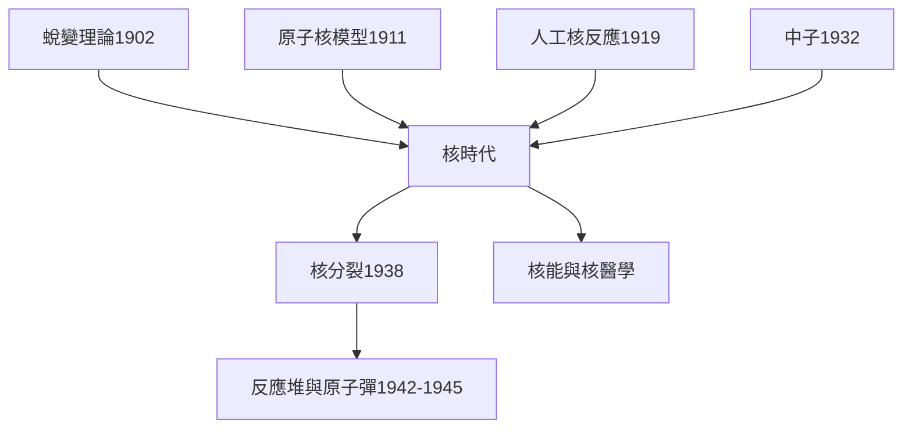

# 5.3 核時代的遺產與身後名

1932年之後，核物理進入爆發期，而拉塞福的態度卻耐人尋味。1933年，他在英國科學促進會演講中說：把原子內部能量轉化為大規模能源的想法是「空談」（moonshine）。這句話應放在因果脈絡中理解：當時中子剛被發現，鏈式反應概念尚未成形，以α粒子或質子轟擊核的效率極低，他的悲觀有其實驗依據。然而也正是他，1934年主持了最早的氘—氘聚變實驗之一，並見證人工放射性（約里奧-居里夫婦）的問世。歷史的弔詭在於：他打開的門，通往他未能預見的世界。

1938年，費米與哈恩一系的研究最終導致核分裂的發現；1942年芝加哥反應堆點火；1945年原子彈試爆。這一切都可以沿著因果鏈回溯到拉塞福：蛻變理論、原子核模型、人工核反應、中子——四塊基石全由他奠定或促成。他本人於1937年去世，未能目睹鏈式反應與廣島，也許因此免於面對自己遺產中最沉重的一頁。

他的身後名極為隆盛：西敏寺安葬，第104號化學元素以他命名（𬬻，Rutherfordium），月球與火星有以他命名的坑洞，紐西蘭將他的肖像印上百元鈔票。科學史上，他與伽利略、法拉第一樣，屬於「開創實驗科學範式」的人物：不僅發現了原子核，更發明了一套以簡單實驗撬動深層自然的研究方法，並透過學派把方法傳承下去。

**因果分析**：拉塞福的四項奠基成果構成核時代的充分條件鏈，但「開啟知識之門」與「決定門後用途」是兩個不同的因果環節。他一生以純粹求知為業、並對武器化持保留態度；核時代的倫理重擔，最終落在後人肩上。理解這一區分，是評價這位原子核物理之父的關鍵——他給了人類改變物質的鑰匙，而如何使用，是科學與社會必須共同回答的持續問題。
