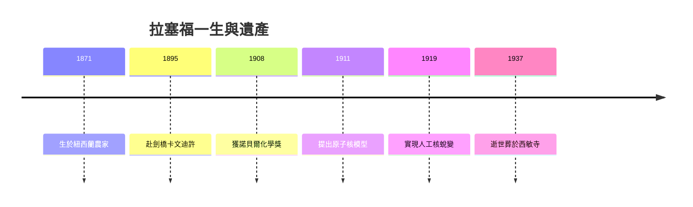

# 5.3 遺產從原子核到核時代

1931年拉塞福受封納爾遜勳爵，1930年起任皇家學會會長，成為英國科學界的領袖。他晚年熱心提攜後進，資助逃離歐陸的學者，維護科學的國際主義精神。1937年10月19日，他因臍疝手術併發症在劍橋逝世，享年六十六歲，葬於西敏寺牛頓墓旁，國王與各國使節前往致哀。從紐西蘭農家到西敏寺墓穴，他走完了殖民地少年難以想像的道路。

他的科學遺產層層遞進，互相驅動：甲乙分類催生蛻變理論，蛻變理論催生核模型，核模型催生波耳原子與量子力學，人工蛻變與中子預言則催生加速器、核分裂與核能。拉塞福本人對核能的實用前景曾持懷疑態度，卻親手培養了開啟核時代的一代人。原子核物理之父的稱號不僅屬於他的發現，更屬於他建立的研究傳統，即以簡單實驗追問根本問題，以團隊合作延續個人洞見。

## 因果分析

- **一生環環相扣的因果鏈** ⟹ 每階段成果皆為下一階段提供工具與問題，形成自我加速的研究飛輪。
- **學派與制度遺產** ⟹ 使個人智慧轉化為集體能力，卡文迪許傳統延續至戰後核時代。
- **從農家到西敏寺** ⟹ 證明開放的獎學金與實驗室制度能跨越階級與地域，持續為科學輸送活水。
