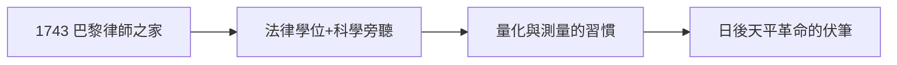

# 1.1 出生與教育（1743–1764）

1743 年 8 月 26 日，安托萬·拉瓦錫（Antoine Lavoisier）出生於巴黎一個富裕的律師家庭。母親早逝，父親悉心培養他接受最好的教育：馬扎然學院（Collège Mazarin），同學中有日後的數學家拉格朗日時代的人物。

## 通才教育

- 1760–64 年在巴黎大學攻讀法律並獲學位（順從父意）；
- 業餘追隨天文學家拉卡伊（La Caille）、化學家魯埃爾（Rouelle）聽課；
- 1764 年發表第一篇論文：關於城市路燈照明的物理研究——已經顯露出「用測量解決實際問題」的風格。

## 地質考察

1760 年代，他隨蓋塔爾（Guettard）做地質考察，繪製法國第一幅地質圖的部分圖幅。野外工作訓練了他記述精確、量化一切的習慣。

**因果**：法律訓練給了他「定義—舉證」的思維，地質考察給了他野外量測的耐心。一個富家子沒有變成紈絝，而是變成測量狂——下一節，包稅公司的財富將為這種狂熱買單。
