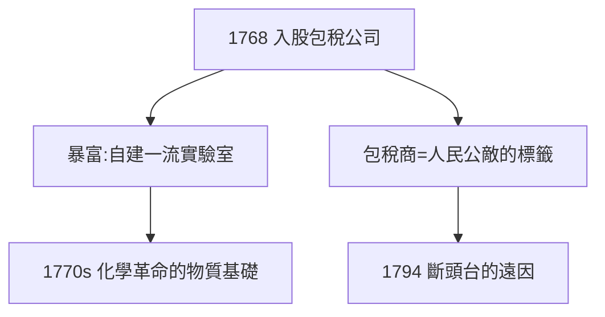

# 1.2 包稅公司（1768–1771）

## 最富有的科學家

1768 年，25 歲的拉瓦錫買下包稅公司（Ferme générale）的股份，成為替王室徵收鹽稅、煙草稅的「包稅商」。這份工作讓他暴富：年收入數十萬鋰，足以自建歐洲最好的私人實驗室，僱用助手、訂製精密天平。

## 雙面人生

- 白天：稅務官員，巡視鹽倉、打擊走私，還寫過改善農業與監獄的報告；
- 晚上：實驗室主人，與夫人瑪麗（Marie-Anne，1762 年 14 歲嫁給他，後來成為他的繪圖員、翻譯與合作者）一起做實驗到深夜。

## 致命的伏筆

包稅商是舊制度下最被仇恨的階層——「人民的吸血鬼」。拉瓦錫再清廉、再有科學貢獻，這個身份在 1793 年都成了死刑判決書上的第一條罪名。

**因果**：同一份工作，既是化學革命的贊助人，也是拉瓦錫之死的掘墓人。財富買來了天平，天平稱出了氧氣，但財富的來源最終要了他的命——這是本書最核心的悲劇結構。
