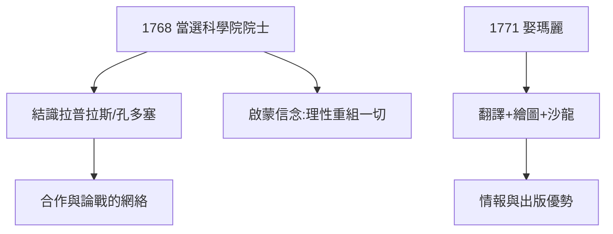

# 1.3 科學院與啟蒙圈（1766–1771）

## 最年輕的院士之一

1766 年，拉瓦錫因論城市照明的論文獲科學院獎；1768 年（25 歲）當選法國科學院通訊院士，正式進入巴黎科學權力中心。在這裡他結識了孔多塞、拉普拉斯、庫侖——啟蒙時代的科學共同體。

## 夫人瑪麗

1771 年娶瑪麗·安妮·皮埃雷特（Marie-Anne Pierrette）。她不只是賢內助：學英語翻譯英國化學文獻（普里斯特利、卡文迪許），繪製實驗儀器圖（《化學綱要》的插圖多出自她手），主持沙龍聚會科學家。沒有她，拉瓦錫的情報網與出版品質都要打折。

## 啟蒙信念

科學院的氛圍是：理性可以重組一切——化學命名、度量衡、稅制、監獄。拉瓦錫把這種信念貫徹到底：**世界是一台可以測量、可以改良的機器**。這既是他成功的根，也是他誤判革命的根（見第 4 章）。

**因果**：科學院給了他舞台與盟友，婚姻給了他實驗室的另一半大腦。1760 年代末，棋子擺好——下一章，他將向統治化學百年的燃素說開第一槍。
