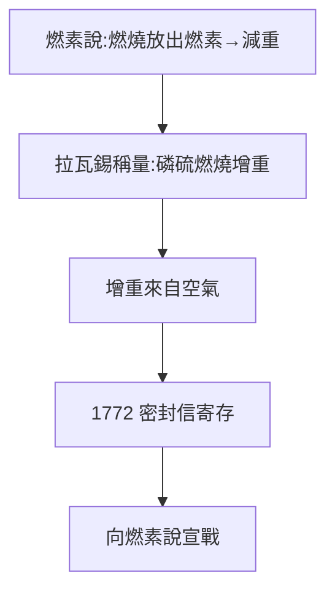

# 2.1 磷硫燃燒實驗（1772）

## 密封信

1772 年 11 月，拉瓦錫向科學院寄存一封密封信，宣稱：磷、硫燃燒後**增重**，增加的重量來自空氣——「空氣進入了燃燒物」。這是向燃素說（認為燃燒是放出「燃素」因而應減重）的公開挑戰。

## 天平即武器

關鍵不在想法，在方法：他用精密天平稱量燃燒前後密閉容器內的總重量，證明增重確鑿。對手（如馬克爾）只能空談「燃素有負重量」之類的遁辭——在秤砣面前，玄學無處藏身。

## 「化學革命」的定義

拉瓦錫後來給革命下的定義就是：**把天平帶進化學**。此前化學是藥房的技藝，此後化學是稱量的科學。1772 年的密封信，是這場革命的獨立宣言。

**因果**：包稅商的財富（1.2）買來了精密天平，天平產出了第一個反常數據。一個重量數字的異常，撬動了百年理論——下一節，氧氣的發現者將把鑰匙送上門。
