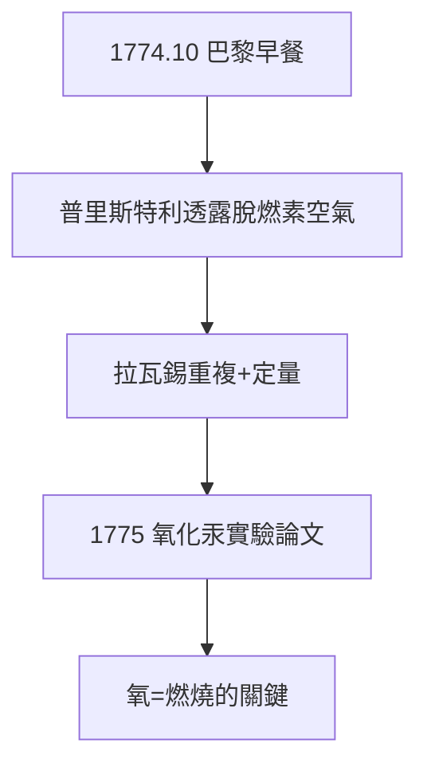

# 2.2 普里斯特利與氧的相遇（1774）

## 1774 年 10 月的早餐

英國化學家普里斯特利（Priestley）隨雇主訪巴黎，與拉瓦錫夫婦共進早餐，閒談中提到自己用聚光加熱氧化汞得到一種「脫燃素空氣」——蠟燭在其中燒得更旺，老鼠活得更久。他沒有意識到這是什麼。

拉瓦錫如獲至寶：這正是他 1772 年預言的「進入燃燒物的空氣」。他立即重複實驗，用精密定量證明：汞煅燒增重的部分 = 釋放出的氣體重量，蠟燭燃燒消耗的正是這種氣體。

## 誰發現了氧

- 1771–72：舍勒（Scheele）最早製得，發表太晚；
- 1774：普里斯特利製得並告知拉瓦錫；
- 1775–77：拉瓦錫定量闡明其在燃燒中的角色並命名 *oxygène*（酸之源，雖然後來證明命名有誤）。

科學史的判決：製備歸舍勒/普里斯特利，**理解歸拉瓦錫**。

**因果**：一頓早餐的閒談，補上了 1772 年假說缺失的氣體環節。拉瓦錫的天才不在製備新氣體，而在把別人的定性發現變成自己的定量理論——下一節，燃素說的喪鐘敲響。
