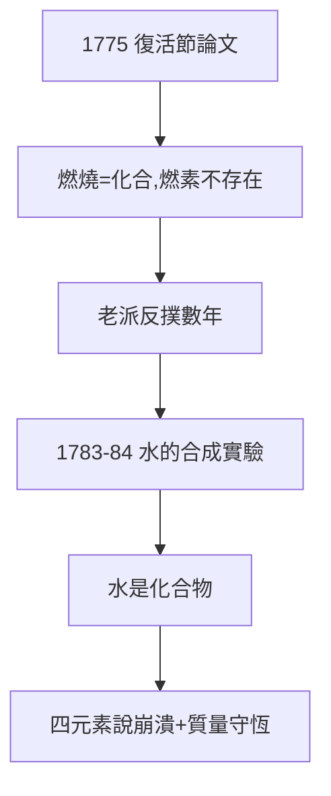

# 2.3 推翻燃素（1775–1777）

## 1775 年復活節論文

拉瓦錫在科學院宣讀《論煅燒的原理》，正式宣布：燃燒是物質與空氣中「最純部分」（氧）的化合，燃素不存在。台下老派化學家譁然——馬克爾等人奮起反駁，論戰持續數年。

## 決定性實驗：水的合成與分解

- 1783–84：與拉普拉斯合作，用大火鏡熔化實驗；與莫沃（Meusnier）合作證明水的合成：氫 + 氧 → 水；
- 卡文迪許在英國也做出水的合成，卻困在燃素框架裡解讀；
- 拉瓦錫的解讀一錘定音：**水是化合物，不是元素**——亞里士多德的四元素說至此徹底崩潰。

## 質量守恆的確立

$$m_{\text{反應前}} = m_{\text{反應後}}$$

這條定律不是他第一個說的（羅蒙諾索夫早有表述），卻是他第一個用系統實驗證明的。從此化學方程式可以配平——現代化學的語法誕生了。

**因果**：1772 年的秤（2.1）+ 1774 年的氣（2.2）= 1775 年的理論。拉瓦錫用五年走完「反常—假說—證實」的全程。下一章，他要把勝利制度化：命名、教科書、度量衡。
