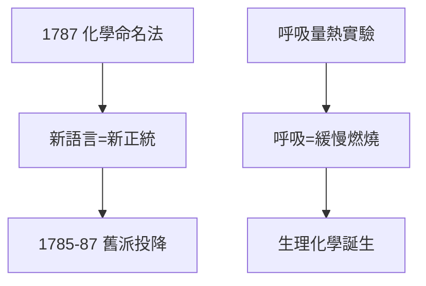

# 3.1 氧學說與命名（1778–1787）

## 1787《化學命名法》

拉瓦錫聯合莫沃、貝托萊、富克魯瓦出版《化學命名法》（Méthode de nomenclature chimique），按氧學說重命名所有物質：氧化物、酸、鹽的系統命名——今天化學課本裡的 *oxide、sulfate、nitrate* 都源於此。語言即權力：接受新名詞，就等於接受新理論。

## 舊派的投降

- 1785：貝托萊（氯氣漂白的發明者）倒戈，公開支持氧學說；
- 1786–87：法國科學院組織大辯論，老派逐一敗退；
- 英國的普里斯特利、卡文迪許至死不改（普里斯特利晚年移居美國，仍寫作捍衛燃素）——革命總有遺老。

## 呼吸也是燃燒

與拉普拉斯合作的冰量熱計實驗證明：動物呼吸消耗氧、放出二氧化碳——**呼吸是一種緩慢的燃燒**。生理學從此有了化學基礎， médecine 與 chimie 在此交匯。

**因果**：理論勝利（2.3）需要語言來鞏固——命名法是化學革命的「憲法」。而呼吸實驗把革命從燒瓶擴展到生命。下一節，教科書將把這一切寫成正典。
