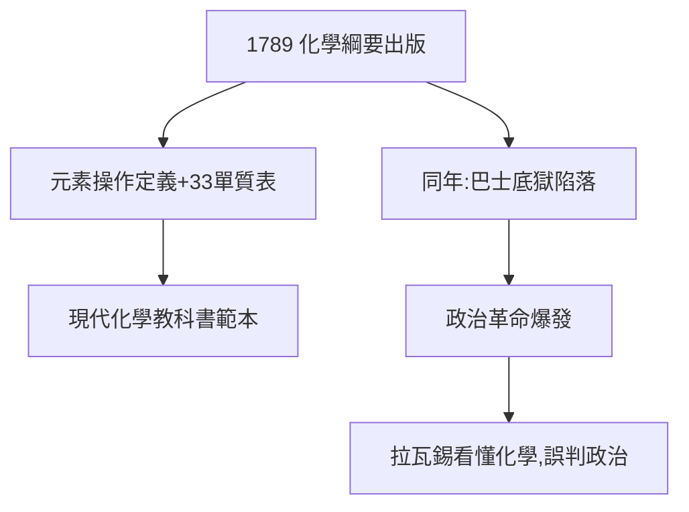

# 3.2 化學綱要（1789）

## 大革命之年的教科書

1789 年——巴士底獄被攻陷的同一年——拉瓦錫出版《化學綱要》（Traité élémentaire de chimie）。全書結構：

1. 氣體的製備與性質；
2. 酸、鹼、鹽的系統；
3. 化學儀器的圖繪（夫人手筆）；
4. 附：化學操作法。

扉頁定義：「**元素是分析所能達到的最後 term**」——操作主義的元素觀，至今仍是化學的哲學基礎。

## 33 種元素表

書末列出 33 種「單質」，包括氧、氫、氮、碳、硫、磷、金屬，以及錯誤的光與熱（calorique）。錯誤留給後人修正，框架千古不移。

## 兩場革命的同年

1789 年法國同時爆發政治革命與化學革命的完成——拉瓦錫站在兩場革命的交點，卻只看懂了其中一場（見第 4 章）。

**因果**：命名法（3.1）是憲法，《綱要》是憲法實施後的第一部法典。而 1789 年的巧合無比諷刺：他為化學立法成功，為國家立法（度量衡、稅制）的努力卻將把他送上斷頭台。
