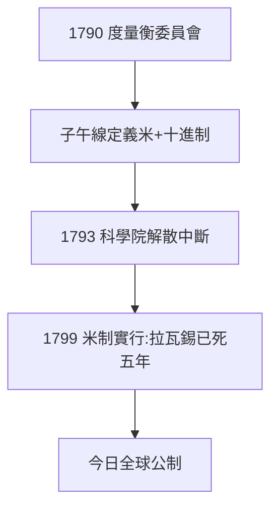

# 3.3 度量衡改革（1790–1793）

## 米的誕生

1790 年起，拉瓦錫作為科學院度量衡委員會秘書，主導統一法國混亂的度量衡：提議以地球子午線的千萬分之一為「米」（mètre），十進制。委員會有拉格朗日、拉普拉斯、庫侖——啟蒙群星最後一次共事。

## 為什麼是化學家管度量衡

- 天平傳統：他比誰都懂「標準」的意義；
- 包稅商經驗：各地稅制度量不一正是徵稅之弊，他深知統一之利；
- 啟蒙信念：理性應當重塑一切人間制度（1.3 的延續）。

## 未完成的事業

1793 年科學院被解散，委員會工作停頓；1799 年米制正式實行時，拉瓦錫已死五年。他種樹，後人乘涼——今天全球（除美、緬、賴三國）通行的公制，起點是他的委員會。

**因果**：從稱量物質（2.1）到稱量國家——度量衡是天平精神的終極擴張。但正是這種「為國家服務」的熱情，讓他在革命中越陷越深。下一章，風暴來臨。
