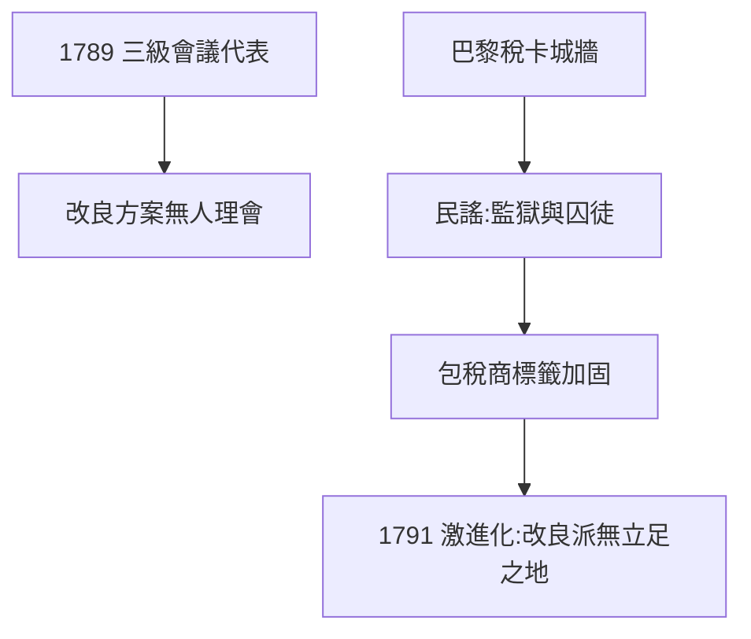

# 4.1 三級會議與改革（1789–1791）

## 開明的改良派

拉瓦錫不是反革命：1789 年他當選三級會議代表（第三等級），提交改革稅制、統一貨幣、改善監獄的方案。他相信理性改良，反對暴力——在一個越來越激進的革命中，這種立場兩面不討好。

## 巴黎城牆的諷刺

他曾主持修建巴黎稅卡城牆（用於徵收城門稅），牆上刻著包稅公司的銘文。巴黎人編順口溜：「城牆把巴黎變成監獄，拉瓦錫把人民變成囚徒。」——科學家的公共工程，在飢餓的群眾眼中只是剝削的象徵。

## 1791 年的轉折

國王出逃、君主立憲破產，革命激進化。拉瓦錫仍在為度量衡委員會工作，以為科學可以超然於政治。他沒有看到：**在革命法庭眼中，沒有超然的科學家，只有包稅商**。

**因果**：啟蒙信念（1.3）讓他相信理性改良，但革命的邏輯是站隊不是講理。城牆事件說明：在飢荒年代，任何與稅收有關的人都是敵人。下一節，科學院本身將被連根拔起。
