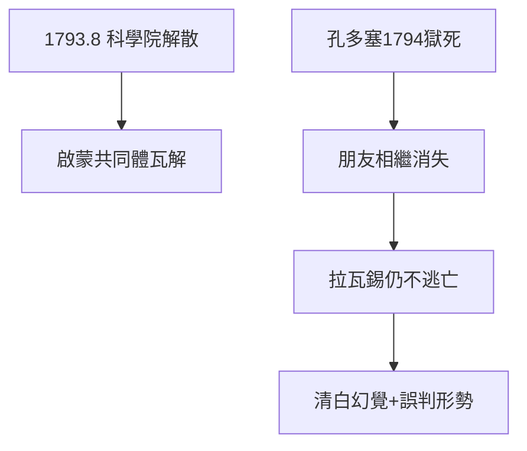

# 4.2 科學院被解散（1793）

## 1793 年 8 月 8 日

國民公會下令解散包括科學院在內的一切舊學術團體，理由是「共和國不需要學者」（據傳富歇語：「共和國不需要科學家」——雖是後人附會，卻反映了時代氣氛）。拉瓦錫奮力陳情，指出火藥、冶金、度量衡都離不開科學家，保住了部分委員會的工作，卻保不住科學院。

## 孔多塞的命運

好友孔多塞因反對憲法被通緝，藏匿中寫下《人類精神進步史表綱要》，1794 年被捕死於獄中。拉瓦錫親眼看著啟蒙圈的朋友一個個消失，卻仍不逃亡——他相信自己的清白與功績可以自辯。

## 不走的理由

- 財產、實驗室、夫人都在巴黎；
- 自信無罪：「我為法國做的貢獻，法庭會看到」；
- 誤判：以為恐怖只是暫時的混亂，理性終將恢復。

三條理由，三條都錯了。

**因果**：科學院的解散是信號——革命不再區分「好貴族」與「壞貴族」、「好包稅商」與「壞包稅商」。拉瓦錫把科學共同體的庇護誤當成個人的免死金牌。下一節，逮捕令到來。
