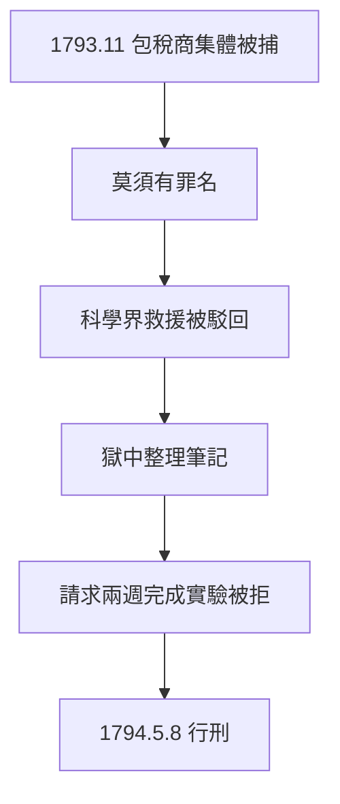

# 4.3 被捕（1793–1794）

## 1793 年 11 月

拉瓦錫與全體包稅公司成員一起被捕，罪名：貪污、走私、與敵國通商（莫須有）。審判是走過場：28 名包稅商被判處死刑，財產充公。科學界的救援（年輕的拉格朗日等人陳情）被駁回——法官據說回答：「共和國不需要科學家。」（此語真偽存疑，但救援失敗是事實。）

## 獄中的最後工作

在監獄裡，他仍在整理實驗筆記，夫人每天探監傳遞紙筆。他請求緩刑兩週以完成一項實驗，法庭拒絕——這是全書最黑暗的一幕：**一個文明拒絕了兩週的時間**。

## 1794 年 5 月 8 日前夜

行刑前夜，他寫信給夫人，囑託保存手稿。信中沒有怨恨，只有遺憾：「我的一生都在為真理工作。」

**因果**：從 1768 年入股包稅公司（1.2）到 1793 年被捕，26 年的伏筆兌現。財富→天平→氧氣→名聲，每一步都推高了他，也一步步把他推向斷頭台——因為在革命眼中，他首先是包稅商，其次才是科學家。
