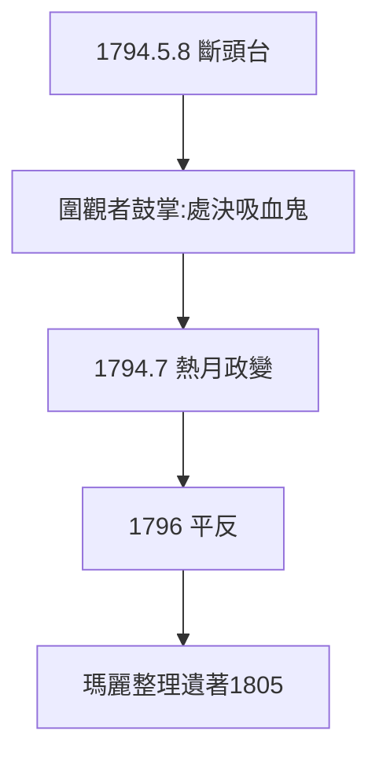

# 5.1 1794 年 5 月 8 日

1794 年 5 月 8 日下午，巴黎革命廣場，拉瓦錫與 27 名包稅商同僚一起被送上斷頭台，年僅 50 歲。據目擊者稱，他神色平靜。鍘刀落下時，圍觀者鼓掌——他們處決的是「吸血鬼」，不是化學家。

## 熱月之後的翻案

- 1794 年 7 月熱月政變，羅伯斯庇爾倒台，恐怖結束；
- 1796 年政府為拉瓦錫平反，歸還部分財產給遺孀；
- 遲到兩年的正義：歷史總是先殺人，後道歉。

## 夫人的餘生

瑪麗改嫁倫福德伯爵（Rumford，熱學研究者）四年後離婚，餘生致力於整理出版拉瓦錫遺著（1805 年《遺著集》）。她活到 1836 年，親眼看到丈夫的理論統治化學。

**因果**：斷頭台是 1.2 的終點，也是 5.3 的起點——人死了，理論不死。下一節，拉格朗日說出科學史上最著名的一句悼詞。
