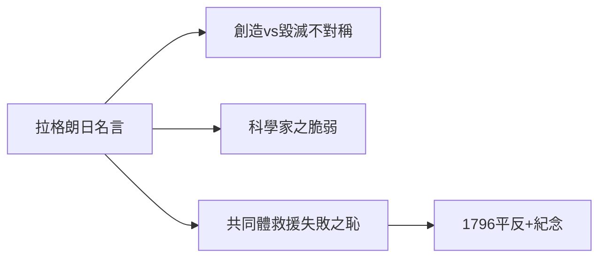

# 5.2 拉格朗日的名言（1794–1796）

## 「砍下這顆頭顱，只需一瞬；再長出同樣的頭腦，一百年也不夠。」

拉格朗日（Lagrange）在拉瓦錫死後說出這句話（Il ne leur a fallu qu'un moment pour faire tomber cette tête, et cent années peut-être ne suffiront pas pour en reproduire une semblable）。無論原話如何，這句話成為科學與權力關係的永恆警句。

## 名言的三層含義

1. **創造與毀滅的不對稱**：建設需要百年，毀滅只需一瞬；
2. **科學家的脆弱**：再大的功績也抵不過一張逮捕令；
3. **共同體的責任**：科學界救援失敗（4.3），是集體的恥辱——拉格朗日本人此後對政治敬而遠之。

## 平反與紀念

- 1796 年平反；
- 巴黎有拉瓦錫廣場、拉瓦錫街；
- 法國化學會最高獎以他命名。

**因果**：一句悼詞把個人悲劇升華為文明教訓。從此「拉瓦錫之死」成為每個科學史課堂的必修課——警示權力，也警示科學家對政治的天真。
