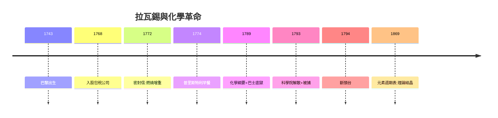

# 5.3 化學世紀（1794–1860）

## 氧學說統治世界

拉瓦錫死後，他的理論反而傳播得更快：

- 1800 年代：道爾頓原子論（1803–08）建立在稱量傳統之上；
- 1811：阿伏伽德羅定律；
- 1860：卡爾斯魯厄會議統一原子量，門捷列夫元素週期表（1869）是《綱要》33 元素表的直系後裔。

## 天平傳統的勝利

分析化學、定量分析、有機元素分析（李比希）——整個 19 世紀化學都是「拉瓦錫式化學」：稱量、配平、命名。

## 最後的因果閉環

**因果閉環**：包稅商的錢買了天平（1.2），天平稱出氧氣（2.1–2.3），氧氣寫成教科書（3.2），教科書培養出道爾頓與門捷列夫（5.3）——而包稅商的身份殺死了作者。拉瓦錫的一生，是「贊助與毀滅同源」的完美悲劇：**殺死他的，正是養活他的**。
