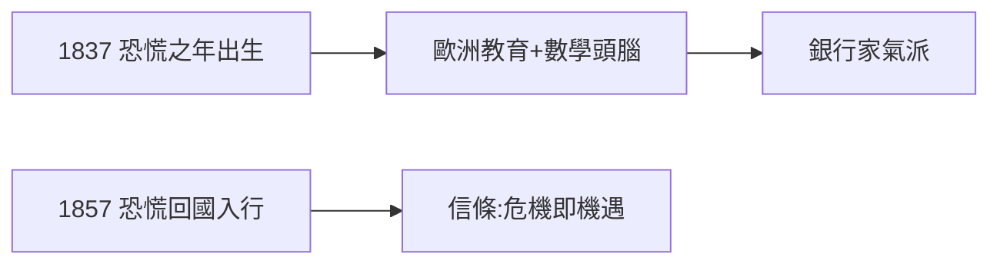

# 1.1 出生與教育（1837–1857）

1837 年 4 月 17 日，約翰·皮爾龐特·摩根（John Pierpont Morgan）出生於康乃狄克州哈特福德——偏偏是美國經濟恐慌（Panic of 1837）之年。父親朱尼厄斯·摩根已是成功的商人，母親患病，家庭氛圍嚴肅。

## 歐洲教育

- 波士頓英文高中 → 瑞士、德國哥廷根求學；
- 數學成績優異，德語流利，養成歐洲式的銀行家氣派；
- 終身的鼻部疾病（rosacea，酒糟鼻）讓他自卑又自負——拍照總是側臉，談判時卻用 staring 壓迫對手。

## 1857：回國入行

恰逢另一次恐慌（1857 年）回國，進入鄧肯商行當學徒。兩次恐慌塑造了他的信條：**危機即機遇，現金為王**。

**因果**：生於恐慌、學於歐洲——摩根的起點就是「舊錢 + 新世界」的結合。下一節，父親朱尼厄斯將把倫敦的人脈交給他。
