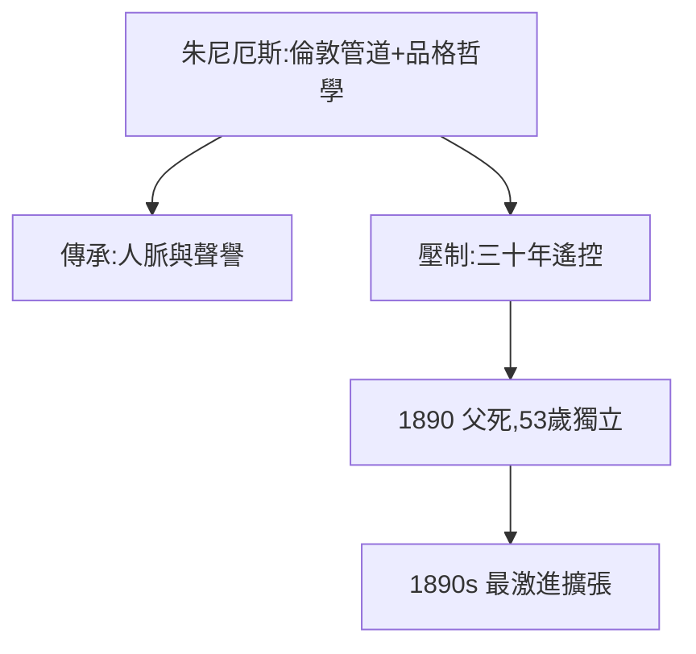

# 1.2 父親朱尼厄斯（1854–1864）

## 倫敦的美國銀行家

朱尼厄斯·摩根（Junius Morgan）1854 年接手倫敦喬治·皮博迪商行，改組為 J.S. Morgan & Co.，成為美國政府與鐵路在歐洲融資的總管道。他的經營哲學：「**品格第一，抵押第二**」——只和信得過的人做生意。

## 父子的傳承與張力

- 朱尼厄斯給兒子的是：倫敦人脈、歐洲資本管道、聲譽；
- 朱尼厄斯不給的是：自由——老摩根控制欲極強，兒子三十多歲仍要請示；
- 1864 年父親讓他在紐約自立門戶（Dabney, Morgan & Co.），但仍遙控。

## 1890：父親去世

朱尼厄斯 1890 年死於車禍（蒙地卡羅）。摩根繼承倫敦事業，終於完全獨立——時年 53 歲。壓抑三十年的能量至此釋放，1890 年代成為他最激進擴張的十年。

**因果**：父親既是階梯也是天花板。1890 年的天花板消失，摩根從「銀行家的兒子」變成「銀行家之王」。下一節，內戰投機將展示他獨立人格的第一課。
