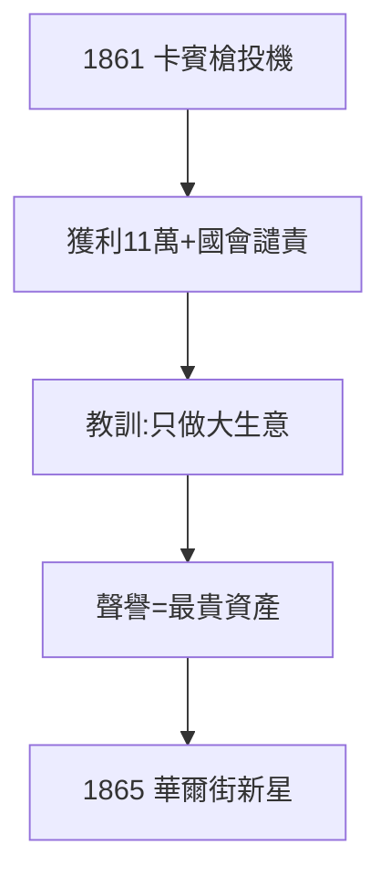

# 1.3 內戰投機（1861–1865）

## 霍爾卡賓槍事件

1861 年南北戰爭爆發，24 歲的摩根參與一樁軍火投機：以 3.5 美元一支買入政府報廢的霍爾卡賓槍，整修後以 22 美元賣回政府，獲利 11 萬美元。國會調查譴責此事，摩根辯稱不知情——這是他人生唯一的醜聞，也是最後一次「小聰明」。

## 教訓：規模與聲譽

- 小投機賺小錢、惹大麻煩；
- 此後他只做「大生意」：鐵路、鋼鐵、國家級融資；
- 「品格第一」的家訓（1.2）從此真正內化——聲譽成了他最貴的資產。

## 戰爭財富

內戰期間為聯邦政府包銷債券、倒賣黃金，原始積累完成。到 1865 年，他已是華爾街嶄露頭角的新星，脫離父親的陰影邁出第一步。

**因果**：一樁醜聞終結了投機客摩根，誕生了銀行家摩根。從此他賭的都是「秩序」而非「混亂」——下一章，他將用三十年把混亂的美國鐵路變成秩序。
