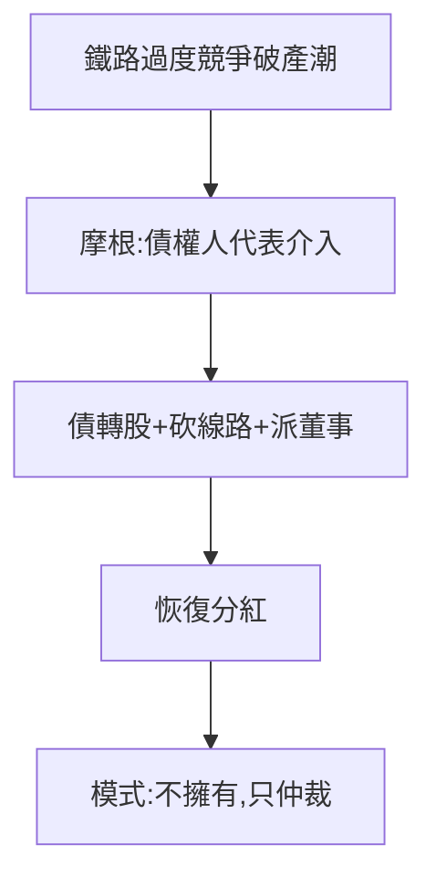

# 2.1 鐵路重組（1869–1879）

## 混亂的鐵路時代

1860–70 年代，美國鐵路過度建設、惡性競爭、輪番破產。摩根看到機會：以債權人代表身份介入破產鐵路，用歐洲資本重組，削減冗餘線路、統一管理——「摩根化」（Morganization）。

## 重組的公式

1. 削減固定債務（債轉股）；
2. 砍掉重複線路，結束價格戰；
3. 董事會加入「摩根的人」，重大決策需他首肯；
4. 恢復分紅，歐洲資本回報。

十年間，他重組了奧爾巴尼-薩斯奎哈納等一系列鐵路，收穫了「鐵路醫生」的名聲與巨額佣金。

## 權力的滋味

重組讓他第一次嚐到「秩序之王」的滋味：不是擁有鐵路，而是**仲裁鐵路**。這種「不擁有、只仲裁」的模式，後來擴展到整個美國工業。

**因果**：卡賓槍的教訓（1.3）——只做大生意、賭秩序。鐵路重組是這套哲學的第一次系統實踐。下一節，德雷克塞爾的加盟將給他全美最大的平台。
