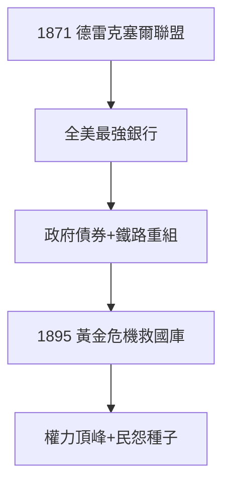

# 2.2 德雷克塞爾合作（1871–1895）

## 1871：聯盟

摩根與費城銀行家安東尼·德雷克塞爾（Anthony Drexel）合組 Drexel, Morgan & Co.，紐約-費城-倫敦-巴黎聯動，一舉成為美國最有實力的銀行。這是他脫離父親體系後的第一個獨立王國。

## 國家級融資

- 1870s：為美國政府包銷內戰債券再融資；
- 1877：重組破產的鐵路帝國；
- 1895：**黃金危機**——美國國庫黃金儲備告罄，摩根聯合歐洲銀行向政府提供 6500 萬美元黃金，拯救美元金本位。總統克利夫蘭在白宮接見他，民眾卻罵他「挾持國家」。

## 1895 年的頂峰

拯救國庫讓摩根達到權力的頂峰：連總統都要向他借錢。但也種下禍根——「銀行家凌駕於國家」的形象，成為進步主義時代攻擊他的彈藥（見 4.2）。

**因果**：從仲裁鐵路（2.1）到仲裁國家——1895 年是摩根權力的珠峰。但珠峰的另一面是懸崖：當銀行家可以拯救國家，國家就遲早要馴服銀行家。下一節的投票信託，是他馴服工業的工具。
