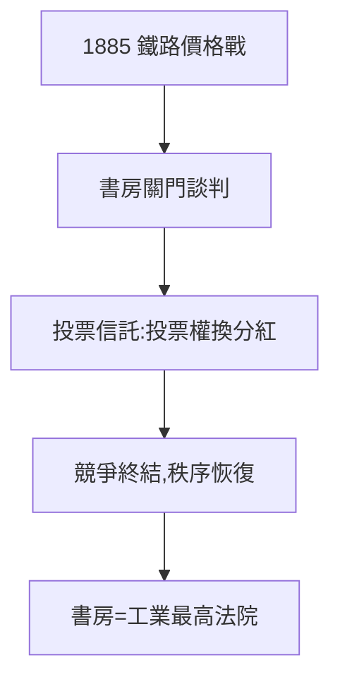

# 2.3 投票信託（1885–1890）

## 1885：紐約中央鐵路之戰

范德比爾特家族的紐約中央鐵路與賓州鐵路惡鬥，股價暴跌。摩根召集雙方到他的 library（他在麥迪遜大道的豪宅書房，後來的大都會藝術館摩根圖書館），關門談判，拿出方案：成立**投票信託**（voting trust）——股東把投票權交給摩根指定的受託人，換取穩定的分紅。

## 信託即秩序

投票信託的本質：用金融契約結束競爭。1885–90 年間，摩根用同一手法「組織」了多條鐵路，被稱為「摩根化」。反對者說這是壟斷，支持者說這結束了浪費性的價格戰。

## 書房政治

摩根的談判風格：雪茄、凝視、沉默，最後一句「就這麼辦」。他的書房成了美國工業的最高法院——不上訴的那種。

**因果**：鐵路重組（2.1）是手術，投票信託是長期處方。摩根完成了從「醫生」到「監護人」的升級。下一章，他將把這套手法從鐵路複製到鋼鐵——美國鋼鐵的誕生。
