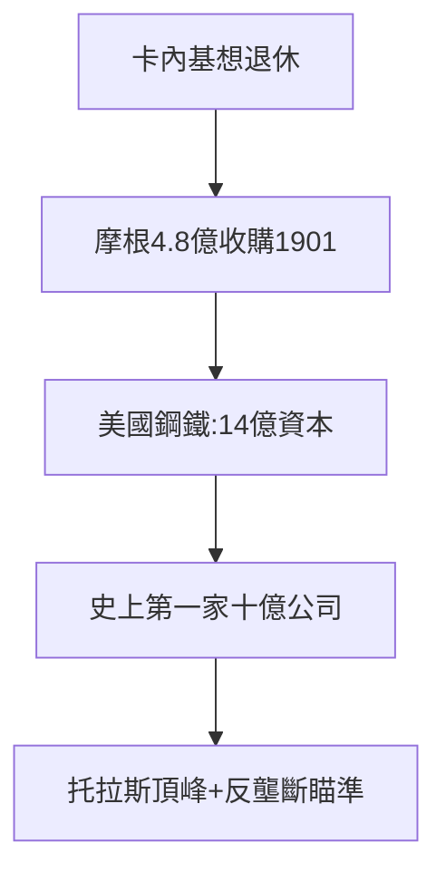

# 3.1 美國鋼鐵（1901）

## 历史上第一家十億美元公司

1901 年，摩根以 4.8 億美元買下卡內基鋼鐵，與其他鋼廠合併為**美國鋼鐵公司**（U.S. Steel）——資本 14 億美元，人類歷史上第一家十億級企業。卡內基拿錢退休，從此當慈善家；摩根得到鋼鐵帝國。

## 交易的藝術

- 卡內基開價 4.8 億（據說寫在紙條上），摩根看了一眼說「成交」，連價都不還；
- 融資結構：債券 + 優先股，摩根系包銷，佣金 6200 萬美元；
- 政治默許：羅斯福總統事先被告知，未加阻攔（三年後卻起訴北方證券，見 3.3）。

## 托拉斯時代的頂峰

美國鋼鐵控制全美 60% 以上的鋼產量。這是「摩根化」從鐵路到工業的完成：**整個行業，一間書房，一支雪茄**。

**因果**：投票信託（2.3）馴服鐵路，美國鋼鐵馴服工業。但規模越大，靶子越大——羅斯福的「托拉斯剋星」人設，正需要這樣一頭大象。下一節，收割機與通用電氣展示同一劇本的重播。
