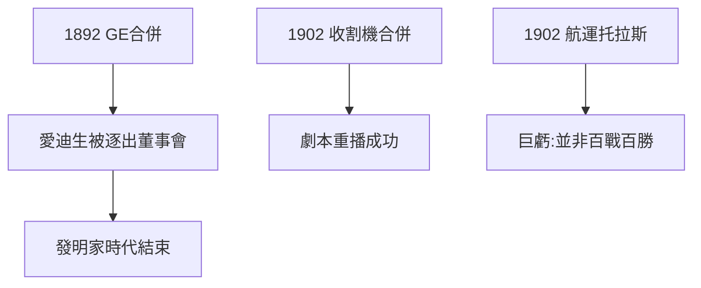

# 3.2 收割機與通用電氣（1892–1902）

## 同一劇本，不同行業

- **1892 通用電氣**：愛迪生通用電氣 + 湯姆生-休士頓合併，摩根主導，愛迪生被踢出自己公司的管理層（愛迪生晚年對此耿耿於懷）；
- **1902 國際收割機**：麥考密克等五家農機廠合併，控制 85% 市場；
- **1902 國際 mercantile marine**：航運托拉斯（唯一失敗之作，巨虧）。

## 摩根的工業邏輯

競爭是浪費，合併是理性；規模帶來穩定，穩定帶來分紅，分紅帶來歐洲資本。這套邏輯在鐵路（第 2 章）驗證過，在鋼鐵（3.1）登峰造極，在航運觸礁——證明他並非百戰百勝。

## 愛迪生的怨念

愛迪生被逐出 GE 董事會一事，象徵一個時代轉換：**發明家的時代結束，金融家的時代開始**。技術天才在資本面前，連自己的公司都保不住。

**因果**：摩根化的複製證明了模式的力量，航運的失敗證明了模式的邊界。而 GE 一事埋下了公眾敘事的轉折：摩根從「秩序製造者」變成「吞噬發明家的資本怪獸」。下一節，政府出手了。
