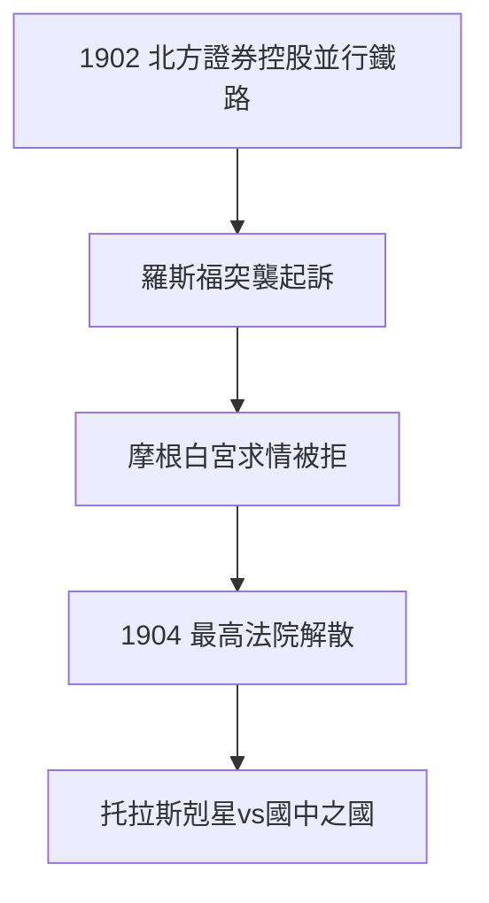

# 3.3 北方證券案（1904）

## 羅斯福的開刀

1902 年，摩根組建北方證券（Northern Securities）控股兩條並行鐵路。羅斯福總統下令司法部依《謝爾曼反托拉斯法》起訴——事先沒有打招呼。摩根震驚，親赴白宮：「如果我們做錯了什麼，派您的人來，我來糾正。」羅斯福回答：「那可不行，我們不希望有人凌駕於法律。」

## 1904：最高法院解散北方證券

5:4 的判決，北方證券解散。這是聯邦政府第一次打贏托拉斯巨頭，羅斯福「托拉斯剋星」名聲大噪，摩根「國中之國」形象定格。

## 1901 年的默契破裂

諷刺的是，1901 年組建美國鋼鐵時羅斯福默許在先。差別在於：鋼鐵是「組織」，北方證券是「赤裸的並行壟斷」；更在於羅斯福需要政績。摩根第一次明白：**政治是比資本更大的權力**。

**因果**：1895 年他拯救國庫（2.2），1904 年國家審判他——權力的鐘擺擺回來了。北方證券案標誌「摩根時代」的頂峰已過。下一章，1907 年恐慌將給他最後一次救世主的機會。
