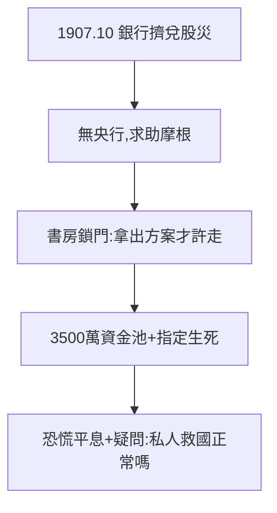

# 4.1 恐慌與救市（1907）

## 1907 年 10 月：華爾街崩潰

信託公司連環倒閉，股市腰斬，銀行擠兌。沒有中央銀行，財政部長求助於 70 歲的摩根。他在書房召集銀行家，**鎖門**——不拿出救市方案不許走，餓了就叫外賣。兩週內，他組織 3500 萬美元資金池，指定哪些信託公司該救、哪些該死，恐慌平息。

## 救世主的黃昏

- 他拯救了華爾街，也順手批准了美國鋼鐵收購田納西煤鐵（順便擴張，羅斯福默許）；
- 舉國歡呼「摩根拯救美國」，但進步主義者提出尖銳問題：**一個私人銀行家能決定國家生死，這正常嗎？**

## 最後的高光

這是摩根一生最後的高光時刻，也是「私人救市」模式的絕唱——因為所有人都看到，必須有一個公共機構來做這件事。

**因果**：1895 年救國庫（2.2）靠的是錢，1907 年救華爾街靠的是權威。兩次救世主經歷，恰恰證明了救世主模式的不可持續——下一節，國會將對「金錢托拉斯」開刀。
