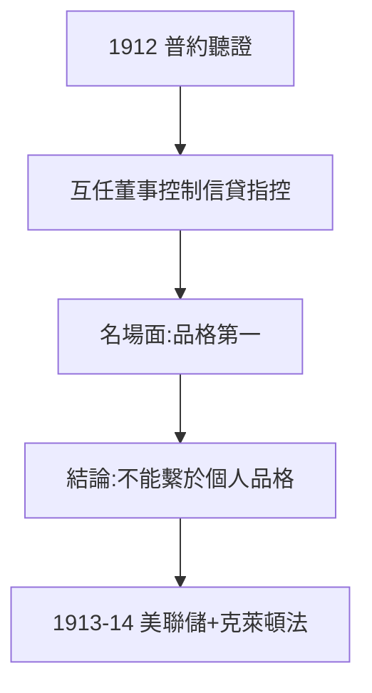

# 4.2 普約聽證（1912）

## 「金錢托拉斯」調查

1912 年，眾議員普約（Pujo）主持聽證，調查「金錢托拉斯」——摩根等少數銀行家通過 interlocking directorates（互任董事）控制全美信貸的指控。75 歲的摩根抱病出庭，律師溫伯格（Untermeyer）詰問三天。

## 名場面：品格與抵押

- 問：「貸款難道不需要物質抵押嗎？」
- 摩根答：「不，先生。**首要的是品格**……我不認識一個不講品格的人。」

這句話成了金融史名言——既是他父親家訓（1.2）的迴響，也是舊時代輓歌：聽證會結論恰恰是，不能把國家信用繫於幾個人的品格。

## 調查的後果

普約報告（1913）認定存在「金錢托拉斯」，直接推動《克萊頓反托拉斯法》（1914）與美聯儲（1913）。摩根贏了辯論，輸了時代。

**因果**：1907 年的救世主（4.1）變成 1912 年的被告——只用了五年。聽證會是「摩根時代」的正式葬禮：國家收回了貨幣權力。下一節，美聯儲接管了他扮演半生的角色。
