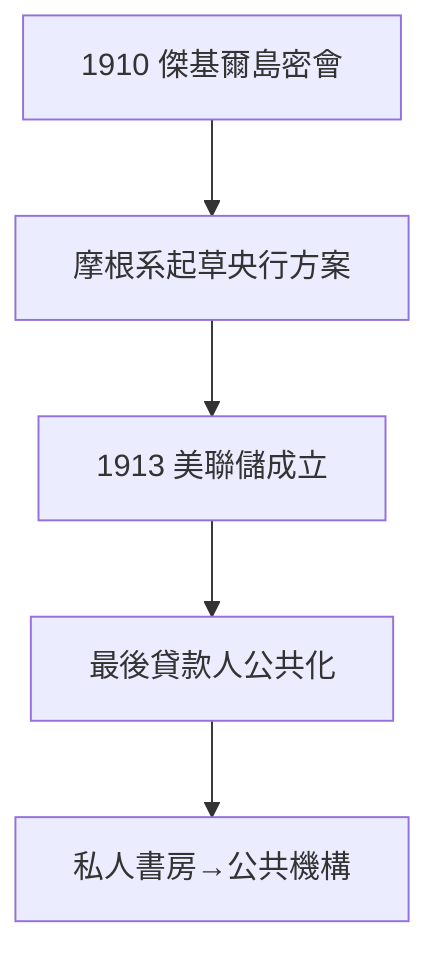

# 4.3 美聯儲的誕生（1913）

## 傑基爾島的秘密會議

1910 年，參議員奧爾德里奇與摩根系銀行家在喬治亞州傑基爾島秘密開會，起草中央銀行方案。諷刺的是：**美聯儲的思想接生者，正是摩根的人**——國家用摩根的方法，取代了摩根本人。

## 1913《聯邦儲備法》

威爾遜總統簽署，美聯儲成立：最後貸款人職能公共化。1907 年摩根在書房裡做的事，從此由華盛頓的委員會來做。

## 權力的轉移

- 從私人書房 → 公共機構；
- 從品格信用 → 制度信用；
- 從摩根 → 國家。

摩根對此的態度是複雜的：他支持有最後貸款人（他比誰都懂恐慌），但不喜歡被監管。1913 年他已病重，沒有力氣再戰。

**因果**：1907 年的成功（4.1）+ 1912 年的審判（4.2）= 1913 年的制度。摩根一生證明了「需要最後貸款人」，歷史的回答是「但不能是你」。下一章，老人謝幕。
