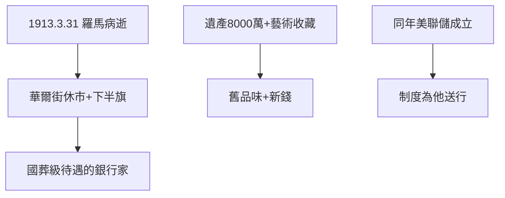

# 5.1 1913 逝世

1913 年 3 月 31 日，摩根在羅馬去世（赴歐養病途中），享年 76 歲。華爾街休市半天，國旗為他下半旗——一個私人銀行家得到國葬級待遇。遺產約 8000 萬美元（遠少於洛克菲勒、卡內基——他愛收藏藝術勝過積累現金）。

## 葬禮的象徵

- 紐約、倫敦同時哀悼；
- 進步主義報紙卻社論：「金錢托拉斯之王死了，托拉斯還在」；
- 同一年的美聯儲成立（4.3），彷彿是為他送行的制度。

## 藝術收藏

大都會藝術館的摩根館藏（中世紀藝術、古籍善本）至今是鎮館之寶。他花錢的方式說明了他：**舊大陸的品味，新大陸的錢**。

**因果**：普約聽證（4.2）耗盡了他最後的精力，1913 年成為終點：人死，制度生。下一節，摩根財團在他死後反而更加壯大——這是另一個故事。
