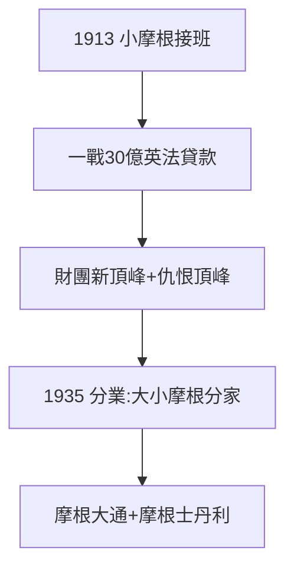

# 5.2 摩根財團的延續（1913–1940）

## 小摩根接班

兒子 J.P. Morgan Jr.（小傑克）接班，一戰期間向英法提供 30 億美元貸款（摩根成為協約國的美國總代理），財團達到新的頂峰。1920 年華爾街爆炸案（針對摩根大樓）說明：仇恨也在頂峰。

## 格拉斯-斯蒂格爾分家（1935）

大蕭條後，《格拉斯-斯蒂格爾法》強制商業銀行與投資銀行分業：摩根士丹利（投資銀行）從 J.P. Morgan（商業銀行）分拆——今天的「大摩」由此誕生。監管完成了普約聽證未竟的事業。

## 財團的長壽

- J.P. Morgan → 摩根大通（2000 年合併，全球最大銀行之一）；
- Morgan Stanley → 全球頂級投行；
- 一個人的書房，變成兩家百年機構。

**因果**：摩根之死（5.1）沒有終結摩根，監管反而讓它開枝散葉。從人到制度（4.3），再從制度到機構——這是資本主義「去人格化」的標準劇本。
