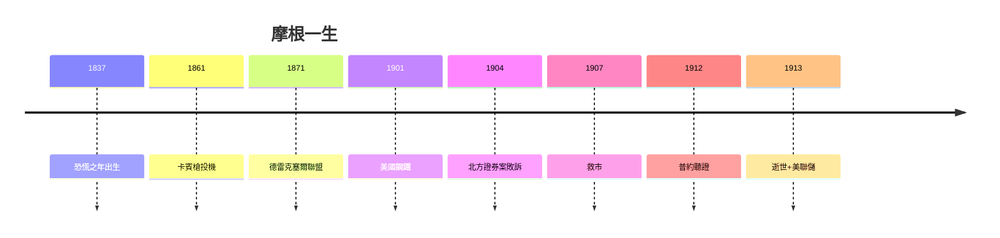

# 5.3 壟斷與進步主義的辯論（1900–2020）

## 兩種摩根敘事

| 辯護 | 控訴 |
|---|---|
| 終結鐵路惡性競爭，節約社會成本 | 扼殺競爭，消費者買單 |
| 1907 年拯救美國 | 1907 年趁機擴張（田納西煤鐵） |
| 品格金融，長期主義 | 金錢托拉斯，民主之敵 |
| 催生現代公司治理（董事會、審計） | 互任董事，內幕控制 |

## 歷史的折中判決

- 摩根的「秩序」確實提高了效率，但也確實需要反壟斷來馴服；
- 美聯儲 + 克萊頓法 = 把摩根的功能留下，把摩根的權力拿走；
- 今天的科技巨頭（平台壟斷 vs 效率）是同一辯論的重播。

**因果閉環**：生於恐慌（1.1），死於監管前夜（5.1）——摩根的一生是美國從「自由競爭」到「有管理的資本主義」的轉型史。他製造秩序，秩序最終不再需要他。這就是「華爾街之王」的全部辯證法。
