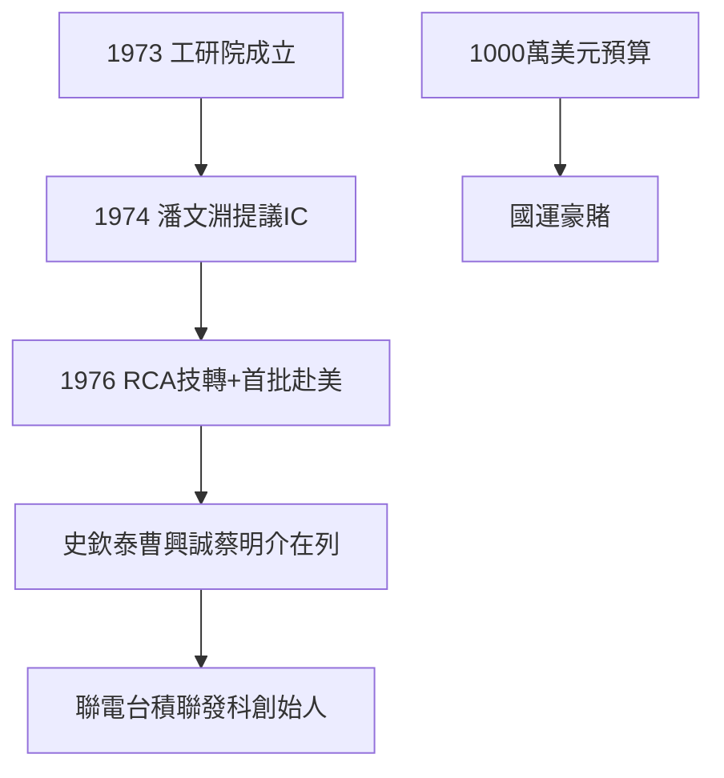

# 1.1 工研院與 RCA 技術移轉（1973–1976）

## 1973：工研院成立

1973 年，經濟部長孫運璿推動成立工業技術研究院（ITRI，院址竹東），把散落各處的公營研究機構整合。1974 年，在美 RCA 微波研究室主任潘文淵回國，與費驊、孫運璿商討產業轉型，提出發展積體電路（IC）——「台灣半導體之父」的稱號，由此而來。

## 1976：RCA 計畫

電子技術顧問委員會（TAC）向十餘家美國半導體廠邀標，最終選定 RCA 的 7 微米 CMOS 製程：技術轉移 + 代訓人員。1976 年，第一批青年工程師赴美受訓——史欽泰、曹興誠、蔡明介、曾繁城……**日後聯電、台積電、聯發科的創始人，全在這批名單裡**。立法院通過 4 年 1000 萬美元預算（約 4 億台幣，當時人均所得僅 400 美元）——一場國運豪賭。

## 豪賭的邏輯

1970 年代台灣做 IC，全世界都覺得瘋了：沒人才、沒市場、沒設備。但孫運璿、李國鼎、潘文淵算的是另一筆帳：電子錶、計算機（見《三愛電子傳》）證明台灣能做電子，缺的只是上游的晶片——**與其代工別人的腦，不如自己長腦**。

**因果**：三愛的計算機（下游需求）+ 技術官僚的眼光 = RCA 計畫。而受訓名單就是台灣半導體的族譜——下一節，園區的誕生。
