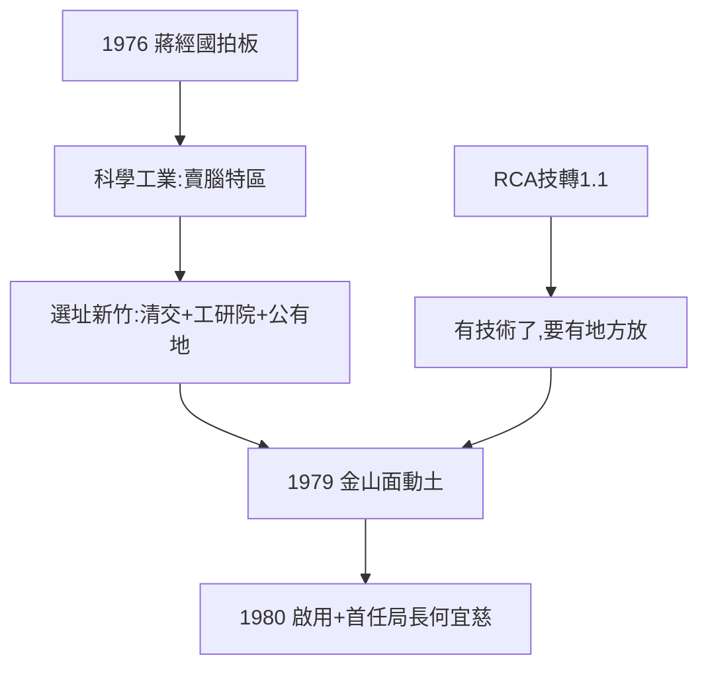

# 1.2 蔣經國拍板與金山面動土（1976–1979）

## 1976：行政院長拍板

1976 年，行政院長蔣經國決定設置「科學工業園區」——國科會評估：台灣人才適合做下游應用科學（半導體製造、電腦周邊、通訊），以腦力密集取代勞力密集。**「科學工業」一詞全球獨創**：不是加工出口區（賣勞力），不是工業區（賣土地），是賣腦力的特區。

## 為什麼是新竹

- 清大（1956 在台復校）、交大（1958 電子研究所）都在新竹——人才庫；
- 工研院在竹東——技術庫；
- 中山高（1978 通車）經過——交通；
- 金山面多為公有地（軍事用地、墓地）——徵收容易，爭議卻延續數十年（見 5.3）。

## 1979：金山面動土

1979 年動土，1980 年完工啟用。首任局長何宜慈（清大校長兼任）——有趣的是，他正是勸林百里「碩士足矣」的那位老師（見《三愛電子傳》1.3）：**勸走一個博士，迎來一個園區**。

**因果**：RCA 計畫（1.1）孵出技術，園區給技術一個家。1976–79 年，台灣同時下注「腦」（工研院）與「房」（園區）——兩注都中，國運就此改寫。下一節，開園。
