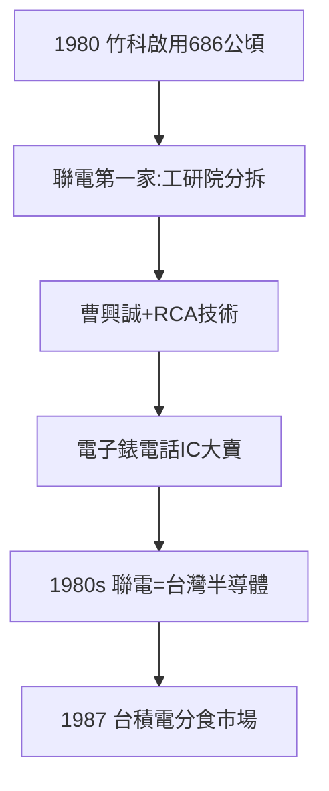

# 1.3 1980 開園與聯電第一家（1980）

## 1980：開園

1980 年，新竹科學園區啟用，面積 686 公頃。第一家登記的公司：聯華電子（UMC）——工研院電子所分拆，曹興誠（RCA 首批受訓，1.1）任首任總經理。**工研院的兒子，住進園區的房子**——研發與生產的臍帶，在開園第一天就接上了。

## 聯電的起手式

- 技術：工研院 CMOS + 後續改良；
- 市場：電子錶、電話 IC（1982 年美國開放電信市場，電話 IC 大賣）；
- 模式：設計 + 製造一體（IDM），接單生產——1980 年代聯電是台灣半導體的全部。

## 1980 年的對照

同年：台積電還沒影子（1987），聯發科還沒影子（1997），三愛電子還在賣音響（見《三愛電子傳》3.3）。竹科開園時，廠商寥寥、雜草叢生——**沒有人知道，這片雜草會長成護國神山**。

**因果**：RCA（1.1）→ 園區（1.2）→ 聯電（本節）。十年播種（1973–80），第一株苗出土。而聯電的獨佔只維持七年——下一個分拆（台積電）已經在路上（第 2 章）。
