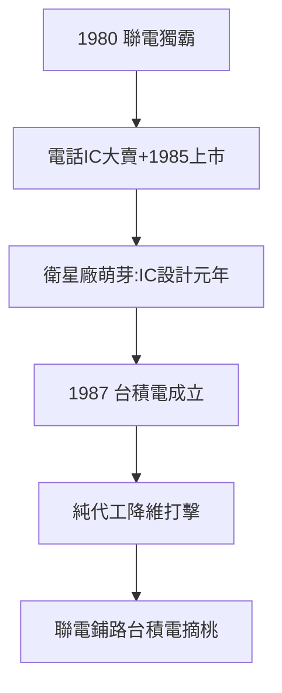

# 2.1 聯電與曹興誠（1980–1987）

## 曹興誠：RCA 首批到聯電掌門

曹興誠（RCA 首批受訓工程師之一，1.1）1980 年任聯電總經理，把工研院的技術變成商品：電子錶 IC、電話 IC、計算機 IC——1980 年代聯電獨霸台灣晶圓代工（其實當時不叫代工，叫 IDM）。他的風格：敢衝、敢罵、敢賭——日後的和艦案、聯電和艦西進爭議，都是這種風格的延續。

## 1980–87：七年獨佔

- 聯電是竹科的代名詞：1980 年第一家，1985 年上市（台灣第一家上市半導體公司）；
- 帶動第一批衛星廠：矽統（1987）、聯詠前身……IC 設計業萌芽——**有晶圓廠，才有 IC 設計**（先有雞，後有蛋的台灣版）；
- 1987 年，獨佔結束：台積電成立（2.3），純代工模式降維打擊。

## 聯電的歷史地位

官方敘事常以台積電為主角，聯電淪為配角。但史實是：**沒有聯電的七年，就沒有台積電的土壤**——技術、人才、供應鏈、資本市場對半導體的信任，全是聯電先賺到的。台積電站在聯電的肩膀上（即使兩家後來打得不可開交）。

**因果**：開園第一家（1.3）→ 七年獨佔 → 養出供應鏈 → 台積電摘桃。聯電的悲劇（被超越）與功績（鋪路）是同一件事——下一節，VLSI 計畫。
