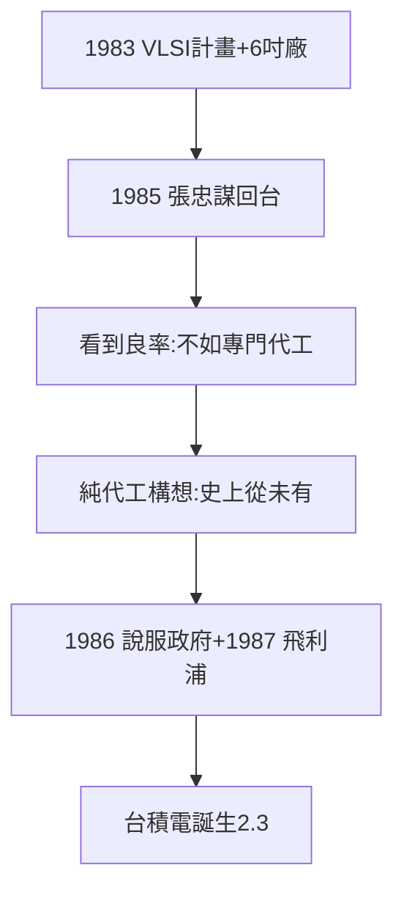

# 2.2 VLSI 計畫與張忠謀回台（1983–1987）

## 1983：超大型積體電路計畫

孫運璿（行政院長）、李國鼎（政務委員）推動 VLSI 計畫：研發次微米製程，興建 6 吋實驗工廠（原規劃 5 吋，因預算晚一年，乾脆蓋 6 吋——**拖延的紅利**）。主持人曾繁城（RCA 首批，1.1）——又是那批名單。

## 1985：張忠謀回台

在德州儀器做到資深副總裁的張忠謀（1931–，浙江人，哈佛 MIT 史丹福三學位）受邀回台接工研院院長。他看到實驗工廠良率極佳，判斷：與其自己做產品，不如**專門幫人代工**——純晶圓代工（pure-play foundry）的構想，人類歷史上從未有人做過（IDM 是常識：自己設計自己造）。

## 構想的憑據

- 工研院的技術（RCA 血統，1.1）+ 實驗工廠（VLSI）+ 竹科的群聚（聯電養出的供應鏈，2.1）；
- 張忠謀的 TI 經驗：知道 IDM 廠的痛（產能閒置）與 IC 設計公司的痛（沒廠下單）——**同時懂兩邊的痛，才能做中間的橋**；
- 1986 年說服政府 + 1987 年說服飛利浦合資——台積電誕生（2.3）。

**因果**：RCA 的技術（1.1）→ VLSI 的工廠 → 張忠謀的橋。二十年（1960s 留學 → 1985 回台）繞了一圈，TI 的副總裁回來為台灣打工——而打工的成果，是人類最賺錢的公司之一。下一節，1987。
