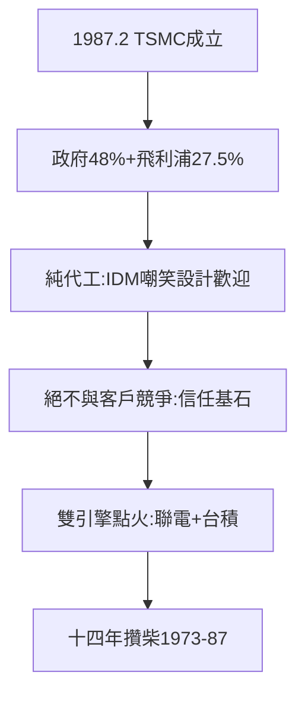

# 2.3 台積電誕生（1987）

## 1987 年 2 月：TSMC 成立

台灣積體電路製造公司（TSMC）在竹科成立：政府（行政院開發基金）48%、飛利浦 27.5%、民間 24.5%，資本額 220 億（當時天文數字）。董事長張忠謀，總經理曾繁城——**RCA 名單（1.1）的兩位，再聚首**。

## 純代工：沒人相信的模式

- IDM 巨頭（英特爾、TI、NEC）嘲笑：幫別人造晶片，能賺什麼錢？
- IC 設計公司（剛萌芽的台灣廠）歡迎：終於有廠可下單——聯發科（1997）還沒出生，但矽統、凌陽們先吃到糖；
- 張忠謀的承諾：「絕不與客戶競爭」（不做設計）——信任的基石，三十年不變。

## 1987 年的意義

竹科開園七年（1980–87），從一家（聯電）變兩家（+台積電），從 IDM 變代工。**台灣半導體的雙引擎，在此點火**——而點火的柴（技術、人才、群聚），全是過去十四年（1973–87）攢的。

**因果**：VLSI 的工廠（2.2）+ 飛利浦的技術 + 聯電的供應鏈（2.1）= 台積電。1987 年之後，竹科進入快車道——下一章，擴張年代。
