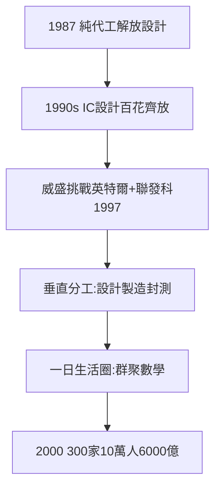

# 3.1 IC 設計與 PC 聚落（1990–2000）

## 有廠下單，百花齊放

台積電的純代工（2.3）解放了 IC 設計：不用建廠，人人可創業。1990 年代竹科冒出一串名字——

- **矽統**（1987，華碩施崇棠出身）、**凌陽**、**瑞昱**（1987，黃崇仁）、**鈺創**；
- **威盛**（1992，王雪紅+陳文琦，挑戰英特爾）；
- **聯發科**（1997，蔡明介，RCA 首批家屬？不——蔡明介本人就是 RCA 首批受訓（1.1），繞了一圈回來創業）；
- PC 週邊：宏碁（施振榮，1976 創立，總部雖在台北，與竹科共生）、華碩、技嘉。

## 垂直分工的台灣模式

美國是 IDM（英特爾通吃），台灣是分工：設計（竹科）+ 製造（台積聯電）+ 封測（日月光，高雄）——**全球最細的分工鏈，全在一日生活圈內**。群聚的數學：距離越近，交易成本越低，創新越快。

## 2000：網路泡沫前夜

2000 年，竹科廠商數破 300 家，從業員工破 10 萬，營業額逼近 6000 億。泡沫前夜的狂歡——泡沫破了會怎樣？（見 4.1，2001 年竹科第一次負成長，但沒死，反而更強。）

**因果**：台積電的橋（2.3）→ 設計業過橋 → 聚落。而聚落的下一步是沒地方住——廠商太多，686 公頃不夠了（下一節：擴建）。
