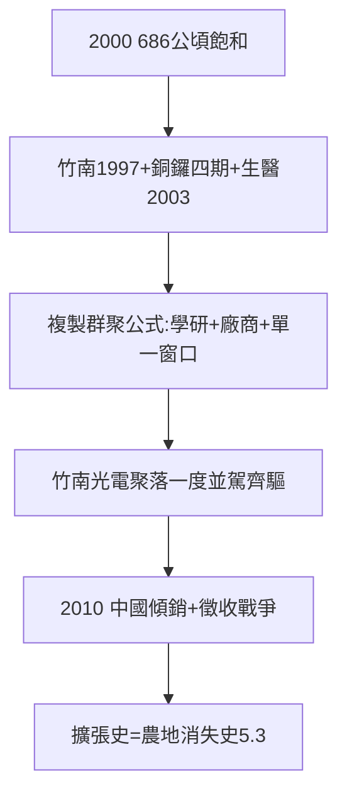

# 3.2 竹南銅鑼擴建（1997–2010）

## 地不夠了

2000 年前後，竹科 686 公頃飽和，廠商排隊等土地。解方：竹科管理局升格（國科會下），向外擴張——

- **竹南園區**（苗栗，1997 核定、1999 動工，123 公頃）：光電、LED、太陽能（群創、億光）+ 國家衛生研究院——生技聚落的起點（見 4.2）；
- **銅鑼園區**（苗栗，2000 年代規劃，四期，約 350 公頃）：精密機械、生技；
- **新竹生醫園區**（竹北，2003 核定，2011 啟用）：台大生醫分院 + 育成中心（見 4.2）。

## 擴建的邏輯：複製群聚

竹南複製竹科公式：國衛院（學研）+ 廠商 + 管理局單一窗口。2000 年代竹南的光電聚落（友達、群創）一度與竹科半導體並駕齊驅——直到中國面板傾銷（2010 年後，見 4.1）。

## 土地的代價

每一次擴建都是徵收戰爭：竹南大埔事件（2010，苗栗縣政府區段徵收，張藥房拆遷，雖非竹科直接主導，但同一邏輯）——**園區的擴張史，也是農地的消失史**（見 5.3）。

**因果**：聚落的成功（3.1）→ 地不夠 → 擴建 → 新聚落 + 新衝突。園區像細胞分裂，越分越多——而每一次分裂，都要問農民借地。下一節，破兆。
