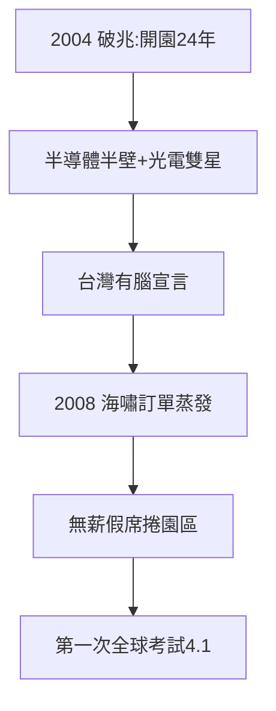

# 3.3 產值破兆（2004–2008）

## 2004：破兆元

2004 年，竹科營業額突破 1 兆元新台幣——開園 24 年（1980–2004），從雜草到兆元。當年全球每三顆 IC，就有一顆與台灣有關；每兩台筆電，就有一台台灣做的。**兆元不是數字，是宣言：台灣有腦**。

## 破兆的組成

- 半導體（台積聯電）約半壁江山；
- 光電（友達、奇美）：2000 年代面板「兩兆雙星」之一（另一兆是半導體）；
- 電腦週邊、通訊、精密機械：群聚的長尾。

## 2008：金融海嘯前夜

2008 年上半年，竹科還在歷史高峰；下半年海嘯來襲，訂單一夜蒸發，無薪假（2008–09，台灣發明的新詞）席捲園區。**破兆四年，就遇到第一次全球性考試**——考題：沒有訂單時，群聚有什麼用？（答案見 4.1：有用，抱團活下去。）

**因果**：聚落（3.1）+ 擴建（3.2）= 破兆。而破兆的脆弱（依賴全球訂單）在 2008 年暴露——下一章，考試與轉型。
