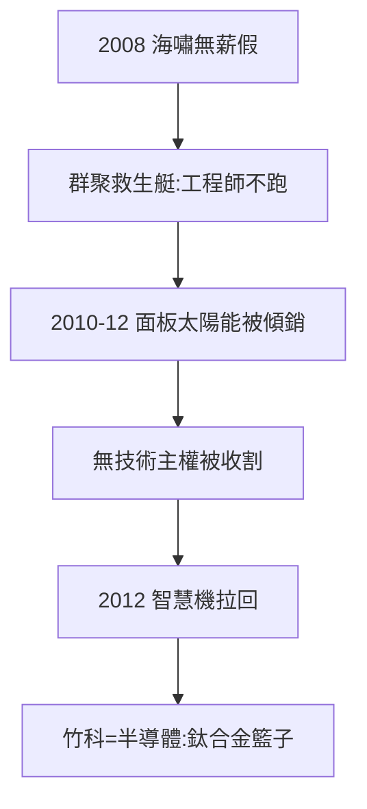

# 4.1 金融海嘯與 LED 太陽能泡沫（2008–2012）

## 2008–09：無薪假

金融海嘯，竹科訂單蒸發三成，廠商放無薪假（不上班、只領底薪，共體時艱）。奇特的是：工程師不跑——因為群聚（3.1）：跳槽走路就到，沒必要離開新竹。**蕭條時，群聚是救生艇**。

## 2010–12：兩兆雙星的殞落（一顆）

- 面板：中國京東方、華星光電在政府補貼下傾銷，友達、群創（竹南）巨虧，「兩兆雙星」的面板一兆破滅；
- 太陽能、LED：2010 年政府力推，茂迪、益通、新日光擴產，2011 年中國尚德、英利傾銷，台灣太陽能全軍覆沒——**政策追風口，風口變刀口**；
- 教訓：有群聚、沒技術主權（面板專利在日韓、太陽能多晶矽在外），照樣被收割——半導體（有主權）與面板（無主權）的對照，是竹科最痛的一課。

## 2012：觸底反彈

半導體（智慧機浪潮：蘋果、三星、聯發科天璣前身）把園區拉回來。2012 年後，竹科越來越等於半導體——**雞蛋放在一個籃子裡，但這個籃子是鈦合金的**。

**因果**：破兆的脆弱（3.3）→ 海嘯考試 → 面板之死 → 半導體獨大。2008–12 年，竹科從「什麼都有」變成「只有半導體最強」——收斂，有時是進化。下一節，生醫的另一條路。
