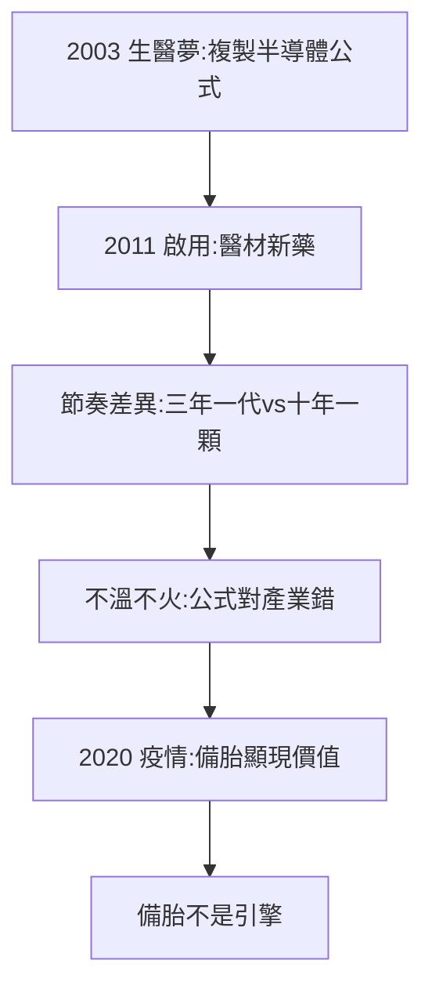

# 4.2 生醫園區（2003–2011）

## 2003：第三個夢

竹科管理局做過電腦、半導體、光電三個夢（都成了），2003 年做第四個夢：生醫。核定新竹生醫園區（竹北）：台大生醫分院 + 產業育成 + 國衛院（竹南）連動——**複製半導體公式（學研 + 廠商 + 單一窗口，見 3.2）到生技**。

## 2011：啟用，生技大樓

2011 年生技大樓啟用，廠商進駐：高階醫材、新藥研發。但生醫與半導體的本質差異浮現：

- 半導體：摩爾定律快，三年一代，群聚加速；
- 生醫：新藥十年一顆，失敗率九成，群聚幫不上忙（失敗不能分攤）；
- 結果：生醫園區不溫不火，遠不如半導體——**公式對了，產業錯了（節奏不同）**。

## 生醫的意義：不在產值，在保險

2020 年疫情，台灣快篩、疫苗（高端）、口罩國家隊，竹北生醫聚落派上用場——產值不大，關鍵時刻有貨。**生醫園區是備胎，不是引擎**——而備胎的價值，只在爆胎時顯現。

**因果**：擴建的邏輯（3.2）→ 生醫複製 → 水土不服 → 疫情正名。2003–20 年，生醫園區證明：群聚不是萬能，產業節奏決定一切。下一節，先進製程。
