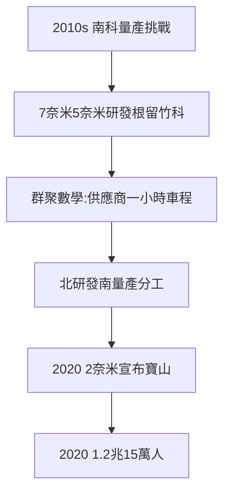

# 4.3 先進製程根留竹科（2010–2020）

## 2010s：南科的挑戰

台積電 12 吋廠大舉南進（南科 14 廠、18 廠），一度傳言「竹科空心化」。但 7 奈米（2018 量產）、5 奈米（2020 量產）的研發與先導生產線，根留竹科（十二廠、十五廠、二十廠皆在竹科/寶山）——**量產可以南移，研發不能離開群聚**（工程師、供應商、清交，都在新竹）。

## 研發的群聚數學

- 先進製程：數百道工序、上千家供應商，一個參數要調三個月——供應商必須在車程一小時內（應用材料、東京威力都在竹科設點，見立法院報告）；
- 南科負責量產（土地大、水電足），竹科負責研發（人才密）——**北研發南量產**，台灣半導體的地理分工；
- 2020 年，台積電宣布 2 奈米落腳寶山（見 5.2）——研發的根，越扎越深。

## 2020：1.2 兆（疫情前夜）

2020 年竹科營業額約 1.2 兆，從業員工逾 15 萬。疫情來襲前，園區已是全球半導體的心臟——而心臟的下一次跳動（5.1），將創歷史紀錄。

**因果**：海嘯後的收斂（4.1：只剩半導體最強）→ 研發群聚 → 南科量產分工。2010–20 年，竹科從「生產基地」升級為「研發大腦」——而大腦的價值，在 2020 年代顯現（第 5 章）。
