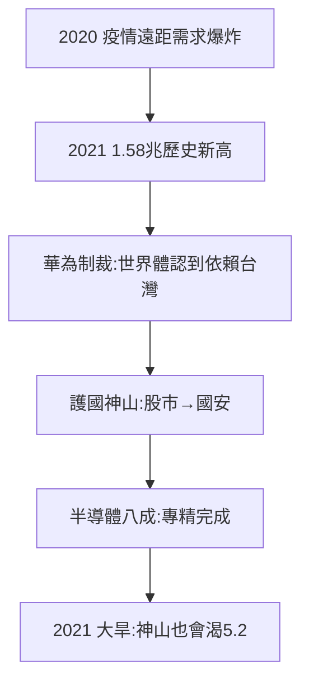

# 5.1 疫情與歷史新高（2020–2021）

## 2020–21：遠距紅利

疫情封鎖全球，筆電、伺服器、遊戲機需求爆炸，晶片缺貨（車用晶片荒 2021）。竹科廠商三班倒：2021 年營業額達約 1.58 兆元，歷史新高——**病毒關了全世界，打開了竹科的訂單**。

## 護國神山的加冕

- 2020 年美國制裁華為，台積電斷供，全球意識到：沒有台灣，世界停擺；
- 「護國神山」從股市術語變成國安術語：半導體 = 台灣的安全籌碼（矽盾）；
- 2021 年百年大旱（見 5.2），台積電鑿井、買水車——神山也會渴。

## 1.58 兆的組成

半導體佔八成以上（台積電一家就逾半），光電、電腦週邊、通訊分食其餘。2004 年破兆（3.3）靠「什麼都有」，2021 年新高靠「只有半導體」——**四十年，從多元到專精**（4.1 收斂的完成）。

**因果**：研發大腦（4.3）+ 疫情需求 = 歷史新高。而新高的陰影（水、電、地）立刻浮現——下一節，寶山與水電。
