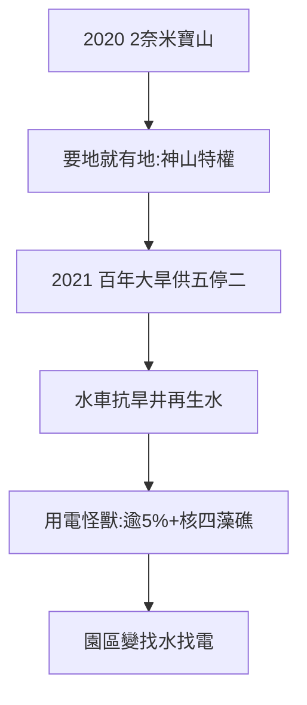

# 5.2 二奈米寶山擴建與水電爭議（2020–2025）

## 2020：2 奈米落腳寶山

台積電宣布 2 奈米廠落腳竹科寶山用地（龍潭？不——寶山一期、二期擴建），環評、徵收、動工一氣呵成。地方政府配合、中央開綠燈——**護國神山要地，沒有拿不到的地**（對照 1979 年金山面，1.2）。

## 2021：百年大旱

台灣 56 年來最大乾旱，竹科實施供五停二（後緩解），台積電出動水車、鑿抗旱井、簽署再生水契約。半導體是用水怪獸（一座 12 吋廠日用水數萬噸）——**神山的阿基里斯腱，是水**。

## 用電：下一個戰場

- 半導體也是用電怪獸：台積電用電佔全台逾 5%（2020 年代），2 奈米更甚；
- 2021–22 核四公投、藻礁公投、三接爭議——能源轉型與半導體擴張的矛盾檯面化；
- 竹科管理局推再生水、海淡、綠電——**園區從招商，變成找水找電**。

**因果**：歷史新高（5.1）→ 資源告急。1979 年的問題是「有沒有地」（1.2），2021 年的問題是「有沒有水電」——四十年，瓶頸從土地變成自然。下一節，兩個世界。
