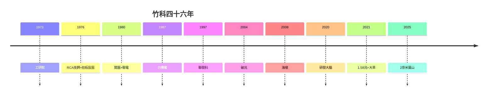

# 5.3 一個新竹兩個世界（1980–2026）

## 園區內外：無形的高牆

竹科創造全台最高所得（園區周邊房價全台前列、雙語學校林立），但舊城區（東門市場、城隍廟一帶）依舊、物價被墊高、年輕人買不起房。學者稱「一個新竹，兩個世界」——**園區的成功，恰恰是舊城區的壓力**。

## 三組對照

| 園區內 | 園區外 |
|---|---|
| 年薪中位數全台最高 | 服務業薪資停滯 |
| 實驗中學、新竹女中明星學區 | 偏鄉學校招生不足 |
| 綠地、自行車道、靜思書軒 | 交通壅塞（慈雲路、公道五） |
| 2 奈米、AI 伺服器 | 金山面老農的徵收記憶（1.2） |

## 未來：園區 2.0？

- 桃竹苗大矽谷計畫（2020 年代）：把竹科經驗複製到桃園、苗栗——但複製得了廠，複製不了清交（人才）；
- 根本的問題：1980 年蔣經國拍板（1.2）時，沒人問農民；2020 年代寶山擴建（5.2），農民學會了問——**民主化的園區，徵收越來越難**；
- 竹科的下一個四十年：從「賣腦」到「賣腦 + 賣永續」（水、電、碳）——瓶頸決定形態，一如既往。

**因果閉環**：工研院的腦（1.1）→ 金山面的地（1.2）→ 聯電的廠（1.3）→ 台積的橋（2.3）→ 聚落的人（3.1）→ 破兆的錢（3.3）→ 海嘯的考（4.1）→ 研發的腦（4.3）→ 神山的盾（5.1）→ 水電的渴（5.2）→ 兩個世界（本節）。**四十六年，竹科把台灣從勞力變成腦力，又把腦力變成國力——而國力的代價，是新竹人共同承擔的水、電、地、房價**。下一個四十年，答案不在工程師手裡，在全民手裡。
