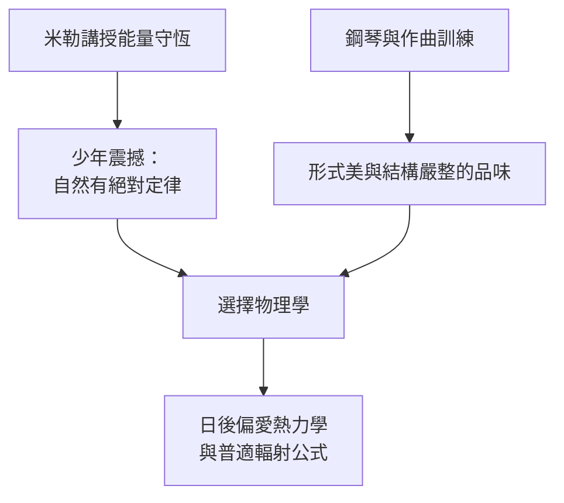

# 1.2 慕尼黑中學與音樂數學的雙軌教育

1867年舉家遷往慕尼黑後，普朗克進入馬克西米利安中學（Maximiliansgymnasium）。這所學校以古典教育著稱，但改變普朗克命運的，是一位數學教師赫爾曼·米勒（Hermann Müller）。米勒講授能量守恆定律時，用了一個農夫磨坊的例子：水輪做功，能量既不憑空產生也不憑空消失，只是不斷轉換形式。普朗克後來回憶，這堂課像一道閃電照亮了他——原來自然界存在著如同神聖律法般絕對不變的定律。這個少年時代的震撼，成為他一生科學信仰的起點：能量守恆是通往自然秩序的第一把鑰匙。

與數學並行的另一條軌道是音樂。普朗克的鋼琴造詣極高，能演奏巴赫全部《平均律鍵盤曲集》，也曾為歌劇譜曲、與愛因斯坦合奏室內樂。他一度認真考慮以音樂為業，最終選擇物理，但音樂的訓練以另一種形式留存下來：他對理論的品味講求形式之美、結構之嚴整，如同對位法中的聲部規則。這種「形式感」日後使他在眾人視為雜訊的黑體輻射數據中，堅信必定存在一個內在和諧的普適公式。

**因果分析**：中學時代是動機層之因。米勒的能量守恆課程供給了科學動機，音樂訓練供給了審美判準，兩者共同作用，使普朗克偏向最冷門卻最像自然法典的熱力學。若無此雙軌教育，他可能成為音樂家或法學家；若無他對絕對普適定律的執著，1900年敢於引入能量子的內插公式，也不會由這樣的人提出。
