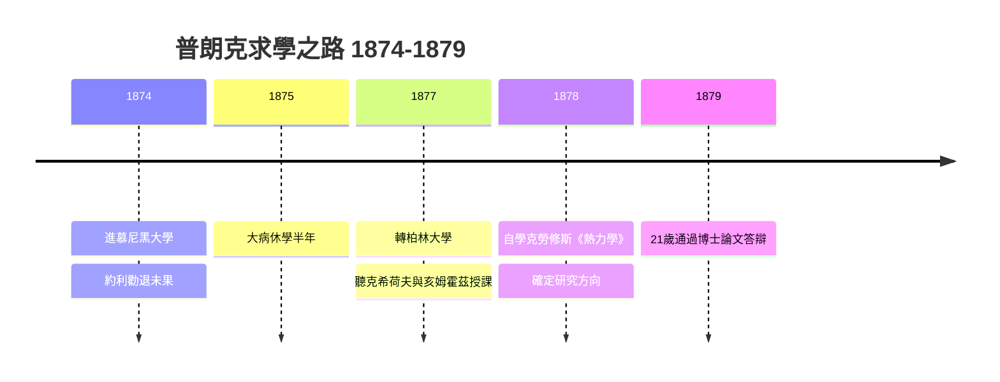

# 1.3 選擇物理：約利的勸阻與不動搖的決心

1874年，十六歲的普朗克進入慕尼黑大學。他原想同時修讀物理與數學，最終偏向物理。入學不久，他拜訪了物理學教授菲利普·馮·約利（Philipp von Jolly），表達想獻身理論物理的志向。約利的回答成為科學史上著名的勸退：「年輕人，物理學的大廈已經完成，剩下的不過是修補細節。」他補充說，在這門接近完工的學科裡不會有重大發現，投入一生並不划算。普朗克答覆：他並不求驚天動地的發現，只想深入理解那些已經奠定的基礎，哪怕只是把現有的認識再推進一小步。

這段對話的意義遠超一段軼事。它揭示普朗克進入物理學的動機是「求理解」而非「求名聲」——這種非功利的心態，正是他日後能在孤獨中長期堅守冷門領域的心理資本。他先在慕尼黑讀了三個學期，因1875年一場大病休養半年，1877年轉往柏林大學，聆聽克希荷夫（Kirchhoff）與亥姆霍茲（Helmholtz）的課，並在醫學與生理學研究所接觸了克勞修斯（Clausius）的熱力學著作——這才是真正決定他研究方向的老師，儘管是以書本的方式。

**因果分析**：約利的勸阻產生了反向驅動：它迫使普朗克回答為何研究物理，而他的答案為理解而研究，使他不依賴外部獎賞，得以在熱力學乏人問津的二十年裡持續耕耘。同時，柏林之行使克勞修斯的熵理論成為他的終身綱領，一路延伸到黑體輻射。沒有1874年的勸退與1878年與克勞修斯的相遇，就不會有量子假說，因為量子假說恰恰是熵與輻射相乘之處結出的果實。
