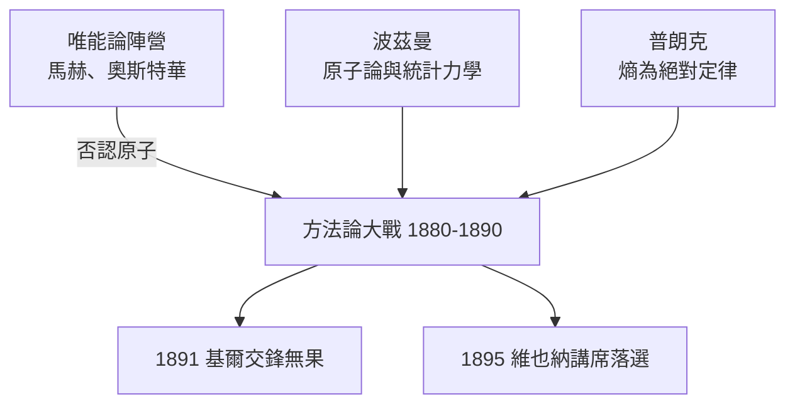

# 2.2 反對原子論的代價：與馬赫、奧斯特華的對峙

1880年代，德國物理學界掀起一場方法論大戰。以馬赫（Ernst Mach）與奧斯特華（Wilhelm Ostwald）為首的「唯能論」陣營主張：原子既然不可觀測，就是形上學的幽靈，科學應只研究能量及其轉換這類可直接測量的量。波茲曼（Ludwig Boltzmann）則孤軍捍衛原子論與統計力學。耐人尋味的是，普朗克站在了兩個陣營之外：他同樣懷疑原子論——不是因為哲學實證主義，而是因為他要把熱力學第二定律立為絕對定律，而原子的統計漲落會摧毀這種絕對性。1882年他發表論文，明確主張熵增定律的嚴格普遍性，反對將其化約為概率。

這場立場的代價慘重。1891年，普朗克與奧斯特華在基爾的天文科學會上當面交鋒，各自陳述唯能論與熱力學的觀點，卻毫無交集——因為奧斯特華根本不承認熵作為基本概念的必要性，而普朗克不承認能量單獨足以構成理論。更深的代價是職業生涯的：1895年波茲曼推薦普朗克接任維也納大學的理論物理講席（繼任波茲曼本人離開的職位），卻因馬赫的反對而落選，職位給了馬赫。普朗克的研究在整個1880年代處於「無人引用、無人反駁、無人繼承」的三無狀態。

**因果分析**：這段對峙的因果鏈極長。直接的因是普朗克的絕對定律信仰與統計漲落不相容，直接的果是孤立與職業挫折。但深層的果更具諷刺性：正因他拒絕原子與統計的現成工具，面對黑體輻射時才必須另闢蹊徑；也正因他執著於熵本身，他才能在1900年把波茲曼公式用於輻射振子，並植入能量分立的假設。偏執與挫折，陰錯陽差地成了革命的助產士。
